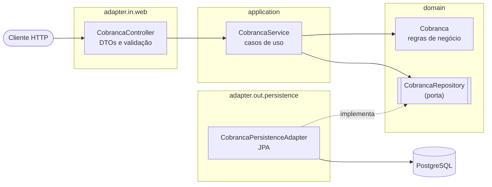

# Plataforma de Cobrança Pix

[](https://github.com/henriteixeiranetto/pix-payment-processing-api/actions/workflows/ci.yml)

API REST para emissão e gestão de **cobranças Pix imediatas**, construída seguindo o contrato da
[API Pix do Banco Central](https://github.com/bacen/pix-api): mesmos endpoints (`/cob`), mesmos campos,
status e tipos de erro. Quem conhece a API Pix de um banco consegue usar esta API sem adaptação.

> Ambiente **simulado**: nenhuma cobrança gerada aqui movimenta dinheiro real.

## O que já funciona

- **Criar cobrança** com txid gerado pelo sistema (`POST /cob`) ou escolhido pelo cliente (`PUT /cob/{txid}`, idempotente)
- **Pix Copia e Cola (BR Code)** gerado para cada cobrança, no padrão EMV com CRC16
- **Consultar** (`GET /cob/{txid}`) e **listar** por período, CPF/CNPJ e status, com paginação (`GET /cob`)
- **Revisar** valor, prazo, devedor ou mensagem e **cancelar** a cobrança (`PATCH /cob/{txid}`), com controle de revisão
- **Validações de domínio**: CPF, CNPJ (inclusive o novo CNPJ alfanumérico), chave Pix (CPF, CNPJ, e-mail, telefone, EVP), txid e valores monetários
- **Erros padronizados** (RFC 9457, `application/problem+json`) com a lista de violações da API Pix
- Documentação interativa com **Swagger UI**, com todos os códigos de resposta e exemplos prontos para testar

## Roadmap

- [x] **Etapa 1: cobranças imediatas.** API `/cob`, BR Code, PostgreSQL + Flyway, testes e CI
- [ ] **Etapa 2: auditoria.** Histórico de cada revisão da cobrança (o que mudou e quando), consultável em `GET /cob/{txid}?revisao=N`, como exige a API Pix
- [ ] **Etapa 3: pagamentos simulados.** "Pagar" uma cobrança pelo Pix Copia e Cola, gerar o Pix recebido (`endToEndId`), marcar a cobrança como `CONCLUIDA` e consultar em `GET /pix`. O banco de quem paga entra como integração externa simulada (porta com adaptador mock), testada com WireMock inclusive em falhas: timeout, retentativa e idempotência (cada `endToEndId` é processado uma única vez)
- [ ] **Etapa 4: conciliação financeira.** Cruzar cobranças com Pix recebidos e apontar divergências (pago a maior ou a menor, pago após expirar, pagamento sem cobrança, cobrança vencida sem pagamento)
- [ ] **Etapa 5: segurança.** OAuth2 *client credentials* com os escopos da API Pix (`cob.write`, `cob.read`, `pix.read`) usando Spring Security; a auditoria passa a registrar também quem fez cada alteração
- [ ] **Etapa 6: webhook.** Notificar o recebedor a cada pagamento, com retentativas
- [ ] **Etapa 7: operação.** Dockerfile da aplicação, métricas e *correlation id* nos logs

## Tecnologias

Java 25 (virtual threads) · Spring Boot 4 · Spring Data JPA · PostgreSQL 17 · Flyway · Bean Validation ·
springdoc-openapi · JUnit 6 · Mockito · Testcontainers · Docker Compose · GitHub Actions

## Arquitetura

Arquitetura hexagonal (portas e adaptadores), organizada por funcionalidade:



```
src/main/java/io/github/henriteixeiranetto/cobrancas
├── cobranca
│   ├── domain                    # Cobranca, Txid, Devedor, regras de status e revisão (Java puro)
│   ├── application               # CobrancaService: orquestra os casos de uso
│   └── adapter
│       ├── in/web                # Controller REST e DTOs no formato da API Pix
│       └── out/persistence       # Entidade JPA, Spring Data e consultas dinâmicas
├── pix                           # ChavePix e geração do BR Code (Pix Copia e Cola)
└── shared                        # CPF/CNPJ, paginação, tratamento de erros e configurações
```

O pacote `domain` não depende de Spring nem de JPA. Por isso as regras de negócio são testadas
sem banco e sem subir a aplicação, e o serviço é testado com um repositório em memória, sem mocks.

## Como rodar

**Pré-requisitos:** JDK 25 ou superior e Docker.

```bash
./mvnw spring-boot:run
```

Com o Docker aberto, o Spring Boot sobe sozinho o PostgreSQL definido em `compose.yaml`.
No Windows, use `mvnw.cmd spring-boot:run`.

- Swagger UI: http://localhost:8080/swagger-ui.html
- Health check: http://localhost:8080/actuator/health
- Requisições prontas: [`http/cobrancas.http`](http/cobrancas.http) (IntelliJ ou VS Code com REST Client)

Para usar um PostgreSQL próprio em vez do Docker, defina `SPRING_DATASOURCE_URL`,
`SPRING_DATASOURCE_USERNAME`, `SPRING_DATASOURCE_PASSWORD` e `SPRING_DOCKER_COMPOSE_ENABLED=false`.

## Exemplo

```bash
curl -X PUT http://localhost:8080/cob/pedido20261106000000000000001 \
  -H "Content-Type: application/json" \
  -d '{
        "calendario": { "expiracao": 3600 },
        "devedor": { "cpf": "12345678909", "nome": "Francisco da Silva" },
        "valor": { "original": "123.45" },
        "chave": "7d9f0335-8dcc-4054-9bf9-0dbd61d36906",
        "solicitacaoPagador": "Cobrança dos serviços prestados."
      }'
```

Resposta `201 Created`:

```json
{
  "calendario": { "criacao": "2026-11-06T13:18:02.710Z", "expiracao": 3600 },
  "txid": "pedido20261106000000000000001",
  "revisao": 0,
  "location": "pix.example.com/qr/v2/9569264b4ceb498e914173c5443d40a3",
  "status": "ATIVA",
  "devedor": { "cpf": "12345678909", "nome": "Francisco da Silva" },
  "valor": { "original": "123.45" },
  "chave": "7d9f0335-8dcc-4054-9bf9-0dbd61d36906",
  "solicitacaoPagador": "Cobrança dos serviços prestados.",
  "pixCopiaECola": "00020101021226760014br.gov.bcb.pix2554pix.example.com/qr/v2/9569264b4ceb498e914173c5443d40a35204000053039865802BR5917Loja Exemplo LTDA6009Sao Paulo62070503***6304D57E"
}
```

Erro de validação, `400 Bad Request` (`application/problem+json`):

```json
{
  "type": "https://pix.bcb.gov.br/api/v2/error/CobOperacaoInvalida",
  "title": "Cobrança inválida.",
  "status": 400,
  "detail": "A requisição que busca alterar ou criar uma cobrança para pagamento imediato não respeita o schema ou está semanticamente errada.",
  "instance": "/cob",
  "violacoes": [
    { "razao": "O campo cob.valor.original não respeita o schema.", "propriedade": "cob.valor.original" }
  ]
}
```

## Decisões técnicas

| Decisão | Motivo |
|---|---|
| Seguir o contrato da API Pix do BCB | É o padrão que todo banco brasileiro implementa; a API fica familiar para quem integra com Pix. |
| `PUT /cob/{txid}` idempotente | O cliente escolhe o txid. Se a resposta se perder e ele repetir a requisição, nenhuma cobrança duplicada é criada (responde `200` em vez de `201`). |
| Revisão só sobe quando algo muda | Os dados da cobrança são um `record`: comparar o antes e o depois diz se houve alteração. |
| BR Code implementado do zero | Campos TLV do padrão EMV e CRC16-CCITT, testados contra o exemplo oficial do Manual de Padrões para Iniciação do Pix. |
| CNPJ alfanumérico | Formato em vigor desde julho de 2026 (IN RFB nº 2.229/2024), já adotado pela API Pix. O mesmo cálculo de dígitos atende CNPJs antigos e novos. |
| Dinheiro em `BigDecimal` e como texto no JSON | Evita erros de arredondamento de ponto flutuante; o formato `"123.45"` é o da API Pix. |
| Lock otimista (`@Version`) | Duas alterações simultâneas na mesma cobrança: a segunda recebe `409 Conflict` em vez de sobrescrever a primeira sem perceber. |
| Flyway + `ddl-auto: validate` | O schema é versionado em SQL; o Hibernate só confere, na subida, se as entidades batem com o banco. |
| `Clock` injetável | Data e hora controladas nos testes, sem depender do relógio da máquina. |
| Java 25 com virtual threads | É o LTS atual. Cada requisição roda em uma virtual thread e, desde o Java 24 (JEP 491), elas não ficam presas em blocos `synchronized`: a API atende muitas requisições que esperam banco e rede sem precisar de um pool grande de threads. O limite de acessos simultâneos ao banco continua sendo o pool de conexões. |
| Java moderno | `record`, `sealed interface` (CPF/CNPJ), *pattern matching* no `switch` e `_` para parâmetros não usados. |

## Testes

```bash
./mvnw verify
```

| Camada | Como é testada |
|---|---|
| Domínio (CPF, CNPJ, chave Pix, txid, regras da cobrança) | Testes de unidade puros, incluindo casos parametrizados |
| BR Code | Comparação com o exemplo oficial do BCB e com o vetor de teste padrão do CRC16 |
| Serviço | Repositório em memória e relógio fixo, sem banco e sem mocks |
| API HTTP | `@WebMvcTest`: formato do JSON, códigos de status e respostas de erro |
| Integração | `@SpringBootTest` + Testcontainers: fluxo completo contra um PostgreSQL real, com as migrações do Flyway |

Os testes de integração precisam do Docker; sem ele, são pulados localmente e rodam no GitHub Actions.

## Diferenças em relação à API Pix real

Este projeto simula o lado do PSP recebedor (a instituição que emite a cobrança). Ainda não implementa:

- autenticação mTLS + OAuth2 (prevista na etapa 5);
- publicação do payload no `location` (assinado com JWS na API real), então o QR Code não é lido por aplicativos de banco;
- histórico de revisões (`GET /cob/{txid}?revisao=N`), previsto na etapa 2;
- os campos `infoAdicionais`, `loc`, `valor.modalidadeAlteracao`, `retirada` (Pix Saque/Troco) e `tributo`;
- remover um campo opcional via `PATCH` (por exemplo, apagar o devedor).

## Autor

Henrique Teixeira Netto · [GitHub](https://github.com/henriteixeiranetto)
